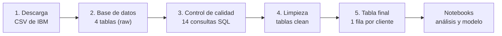

# Customer Churn Analysis & Prediction

**Análisis y predicción del abandono de clientes con SQL, Python y Machine Learning.**

> **Estado del proyecto:** en desarrollo. Están terminados el diseño, la preparación de datos, el SQL y la limpieza (fases 1 y 2). Lo siguiente es el análisis estadístico. [Ver hoja de ruta](#estado-del-proyecto).

---

## ¿Qué es este proyecto?

Una empresa de telecomunicaciones pierde clientes cada mes: se dan de baja. A ese abandono se le llama **churn**. Este proyecto quiere responder una pregunta de negocio:

> **¿Qué tienen en común los clientes que se van, y podemos detectar a tiempo a los que tienen más riesgo de irse?**

Para responderla, el proyecto:

1. **Descarga** los datos de 7.043 clientes.
2. **Los organiza** en una base de datos, como estarían en una empresa real, y **los revisa con SQL** en busca de errores.
3. **Los limpia**, explicando el motivo de cada corrección.
4. **Construye una tabla final** con una fila por cliente, lista para analizar.
5. *(Próximas fases)* Los **analiza con estadística**, **entrena un modelo** que estima el riesgo de cada cliente y termina con **recomendaciones** para el negocio.

> **Sobre los datos:** son de una empresa **ficticia** creada por IBM para practicar análisis de datos, con licencia Apache 2.0. No contienen información de personas reales.

---

## Índice

- [Guía rápida (si ya sabes programar)](#guía-rápida-si-ya-sabes-programar)
- [Guía paso a paso (si es tu primera vez)](#guía-paso-a-paso-si-es-tu-primera-vez)
- [¿Cómo funciona por dentro?](#cómo-funciona-por-dentro)
- [Qué hay en cada carpeta](#qué-hay-en-cada-carpeta)
- [Problemas frecuentes](#problemas-frecuentes)
- [Glosario](#glosario)
- [Estado del proyecto](#estado-del-proyecto)
- [Documentación, datos y licencia](#documentación-datos-y-licencia)

---

## Guía rápida (si ya sabes programar)

Requisitos: Python 3.11 o superior (probado con 3.13) y Git.

```bash
git clone https://github.com/JavierMolero12/customer-churn-analysis.git
cd customer-churn-analysis
python -m venv .venv
source .venv/bin/activate        # Windows: .venv\Scripts\activate
python -m pip install -r requirements.txt
python -m src.pipeline           # descarga, base de datos, limpieza y tabla final (~5 s)
python -m pytest                 # 15 tests
jupyter lab                      # notebooks en notebooks/
```

---

## Guía paso a paso (si es tu primera vez)

No necesitas saber programar. Sigue los pasos en orden: cada uno dice **qué escribir**, **qué hace** y **qué deberías ver**.

### Antes de empezar

Vas a necesitar:

- Un ordenador con **Windows, macOS o Linux**.
- **Conexión a internet** (solo la primera vez, para descargar el proyecto y sus librerías).
- **Unos 15 minutos** y **1 GB libre** en el disco (las librerías ocupan unos 650 MB).

> **Cómo leer esta guía:** todo lo que aparece en un **recuadro gris** se escribe en la *terminal* (paso 1) y se ejecuta pulsando **Enter**. Escríbelo tal cual o cópialo y pégalo.

---

### Paso 1 — Abre una terminal

La terminal es una ventana en la que escribes órdenes al ordenador en lugar de hacer clic.

| Sistema | Cómo abrirla |
|---|---|
| **Windows** | Pulsa la tecla Windows, escribe `PowerShell` y pulsa Enter. |
| **macOS** | Pulsa `Cmd + Espacio`, escribe `Terminal` y pulsa Enter. |
| **Linux** | Pulsa `Ctrl + Alt + T`. |

---

### Paso 2 — Comprueba que tienes Python

Escribe:

```bash
python --version
```

**Qué deberías ver:** algo como `Python 3.13.1`. Vale cualquier versión **3.11 o superior**.

**¿Sale un error o una versión más antigua?** Instala Python:

1. Entra en [python.org/downloads](https://www.python.org/downloads/) y descarga la última versión.
2. **En Windows, durante la instalación, marca la casilla `Add python.exe to PATH`.** Es el fallo más habitual: sin esa casilla, la terminal no encuentra Python.
3. Cierra la terminal, ábrela de nuevo y repite `python --version`.

> **En macOS** el comando suele llamarse `python3`. Si `python --version` no funciona, prueba `python3 --version`. Si así sí funciona, escribe `python3` en lugar de `python` en todos los pasos.

---

### Paso 3 — Descarga el proyecto

Elige **una** de las dos opciones.

**Opción A — Con Git (recomendada).** Comprueba si tienes Git con `git --version`. Si aparece una versión, escribe:

```bash
git clone https://github.com/JavierMolero12/customer-churn-analysis.git
```

Se crea una carpeta `customer-churn-analysis` con todo el proyecto. Si no tienes Git, puedes instalarlo desde [git-scm.com](https://git-scm.com/downloads) o usar la opción B.

**Opción B — Sin Git.** En la [página del proyecto en GitHub](https://github.com/JavierMolero12/customer-churn-analysis), pulsa el botón verde **`Code`** y después **`Download ZIP`**. Descomprime el ZIP en una carpeta fácil de encontrar, por ejemplo el Escritorio.

---

### Paso 4 — Entra en la carpeta del proyecto

La terminal trabaja siempre "dentro" de una carpeta. Hay que situarla en la del proyecto.

**Si usaste la opción A**, escribe:

```bash
cd customer-churn-analysis
```

**Si usaste la opción B (ZIP)**, lo más fácil en **Windows** es abrir la carpeta descomprimida en el Explorador de archivos, hacer clic en la barra de direcciones de arriba, escribir `powershell` y pulsar Enter. Se abre una terminal ya situada en esa carpeta. En **macOS y Linux**, escribe `cd ` (con un espacio al final), **arrastra la carpeta descomprimida** a la ventana de la terminal para que se escriba su ruta y pulsa Enter.

**Comprueba que estás en el sitio correcto** escribiendo `ls` (en el Símbolo del sistema de Windows, `dir`). Deberías ver, entre otros, `README.md`, `requirements.txt`, `src` y `sql`.

---

### Paso 5 — Crea un entorno virtual

```bash
python -m venv .venv
```

**Qué hace:** crea una carpeta oculta `.venv` donde se instalarán las librerías de este proyecto, **separadas del resto de tu ordenador**. Así no interfiere con otros programas y todo el mundo usa exactamente las mismas versiones.

**Qué deberías ver:** nada. Si después de unos segundos vuelve a aparecer la línea para escribir, ha funcionado.

---

### Paso 6 — Activa el entorno virtual

Activarlo le dice a la terminal: "a partir de ahora, usa el Python de este proyecto".

| Sistema | Escribe |
|---|---|
| **Windows (PowerShell)** | `.venv\Scripts\Activate.ps1` |
| **Windows (Símbolo del sistema / cmd)** | `.venv\Scripts\activate.bat` |
| **macOS / Linux** | `source .venv/bin/activate` |

**Qué deberías ver:** `(.venv)` al principio de la línea de la terminal.

> **¿PowerShell dice que "la ejecución de scripts está deshabilitada en este sistema"?** Es una protección de Windows y **no hace falta cambiar nada**. Sáltate la activación y, en los pasos siguientes, escribe `.venv\Scripts\python` donde ponga `python`. Por ejemplo: `.venv\Scripts\python -m src.pipeline`. Funciona exactamente igual.

> **Importante:** cada vez que abras una terminal nueva tendrás que repetir este paso. Los pasos 3, 4, 5 y 7 solo se hacen una vez.

---

### Paso 7 — Instala las librerías

```bash
python -m pip install -r requirements.txt
```

**Qué hace:** lee el fichero `requirements.txt` e instala las librerías que usa el proyecto (pandas, scikit-learn, jupyter…) **en las versiones exactas con las que se ha probado**.

**Qué deberías ver:** muchas líneas de texto durante unos minutos y, al final, una línea que empieza por `Successfully installed`.

---

### Paso 8 — Ejecuta el proyecto

```bash
python -m src.pipeline
```

**Qué hace**, en unos segundos:

1. Descarga los datos de IBM y comprueba que el fichero es exactamente el esperado.
2. Crea una base de datos con 4 tablas.
3. Busca errores en los datos con 14 comprobaciones SQL.
4. Limpia los datos, explicando cada decisión.
5. Genera la tabla final, con una fila por cliente.

**Qué deberías ver** (en Windows las rutas usan `\` en lugar de `/`):

```text
Dataset descargado y verificado: data/raw/Telco-Customer-Churn.csv
Base de datos creada: data/churn.db
  raw_customers         7,063 filas
  raw_subscriptions     7,043 filas
  raw_services         23,685 filas
  raw_payments        228,080 filas
Defectos inyectados: 200 (manifiesto: data/raw/injected_defects.csv)
Decisiones de limpieza:
        table                                            action  rows_affected
    customers                             drop exact duplicates             20
     payments                              drop orphan payments             30
     payments         drop payments outside subscription period             10
     payments drop duplicated payments (keep lowest payment_id)             50
subscriptions                  standardize contract_type labels             35
subscriptions                 standardize payment_method labels             35
subscriptions      convert total_charges to number (blank -> 0)             11
subscriptions recover missing monthly_charges from last payment             10
subscriptions          fix monthly_charges decimal shift (x100)             10
     services                             drop exact duplicates              0
     services                    drop services without customer              0

Comprobaciones de calidad sobre clean_* con problemas: 0
customer_features: 7,043 clientes x 27 columnas -> data/processed/customer_features.csv
```

La última línea es la importante: **7.043 clientes** en la tabla final y **0 problemas** de calidad tras la limpieza.

---

### Paso 9 — Comprueba que todo está bien

```bash
python -m pytest
```

**Qué hace:** ejecuta los *tests*, pequeños programas que comprueban automáticamente que el proyecto funciona. Por ejemplo, que no hay clientes repetidos o que la limpieza no ha perdido datos.

**Qué deberías ver:** una línea de puntos y, al final, **`15 passed`**. Si alguno fallara, verías `failed` y una explicación del motivo.

---

### Paso 10 — Abre los notebooks

Los *notebooks* son documentos que mezclan explicaciones, código y gráficos. Es donde se cuenta el análisis.

```bash
jupyter lab
```

1. Se abrirá una pestaña en tu navegador.
2. En el panel de la izquierda, entra en la carpeta **`notebooks`** y abre **`01_data_exploration.ipynb`**.
3. Los resultados ya están guardados: puedes **leerlo directamente**. Si quieres ejecutarlo tú, usa el menú **Run → Run All Cells**.

**Para cerrar Jupyter:** cierra la pestaña del navegador, vuelve a la terminal y pulsa `Ctrl + C`.

> **Sin instalar nada:** GitHub muestra los notebooks con sus gráficos. Abre la carpeta `notebooks` en la página del proyecto.

---

### Paso 11 (opcional) — Haz tu primera consulta SQL

Los datos están en una base de datos (`data/churn.db`). Esta orden le pregunta: *de cada tipo de contrato, ¿cuántos clientes hay y qué porcentaje se dio de baja?*

```bash
python -c "import sqlite3, pandas as pd; print(pd.read_sql('SELECT contract_type, COUNT(*) AS clientes, ROUND(100 * AVG(churn), 1) AS churn_pct FROM customer_features GROUP BY contract_type', sqlite3.connect('data/churn.db')))"
```

**Qué deberías ver:**

```text
    contract_type  clientes  churn_pct
0  Month-to-month      3875       42.7
1        One year      1473       11.3
2        Two year      1695        2.8
```

**Pruébalo tú:** cambia las dos apariciones de `contract_type` por `internet_service` o `payment_method` y vuelve a ejecutarlo. Las consultas completas del proyecto están en la carpeta [`sql/`](sql/).

> Si prefieres ver las tablas con ratón en vez de con órdenes, puedes abrir `data/churn.db` con la aplicación gratuita [DB Browser for SQLite](https://sqlitebrowser.org/).

---

### Volver otro día

No hace falta repetirlo todo. Basta con:

1. Abrir la terminal (paso 1).
2. Entrar en la carpeta del proyecto (paso 4).
3. Activar el entorno (paso 6).

A partir de ahí, ya puedes ejecutar `python -m src.pipeline`, `python -m pytest` o `jupyter lab`.

---

## ¿Cómo funciona por dentro?

Piensa en el proyecto como una **cadena de montaje**: cada estación hace una sola tarea y pasa el resultado a la siguiente. El comando `python -m src.pipeline` pone en marcha toda la cadena.



| Paso | Qué hace, en pocas palabras | Código | Resultado |
|---|---|---|---|
| **1. Descarga** | Baja el fichero de IBM y comprueba su "huella digital" (SHA-256) para asegurar que es exactamente el esperado. | [`src/download_data.py`](src/download_data.py) | `data/raw/Telco-Customer-Churn.csv` |
| **2. Base de datos** | Reparte la hoja de cálculo en 4 tablas conectadas, como en los sistemas de una empresa. Además añade **a propósito** 200 errores típicos (duplicados, vacíos, fechas imposibles…) para demostrar que el control de calidad los encuentra. | [`src/build_database.py`](src/build_database.py), [`sql/00_schema.sql`](sql/00_schema.sql) | `data/churn.db` (tablas `raw_*`) |
| **3. Control de calidad** | 14 consultas SQL buscan duplicados, valores vacíos, valores imposibles o extremos, registros sin pareja y fechas incoherentes. | [`sql/01_data_quality.sql`](sql/01_data_quality.sql) | Lista de problemas y filas afectadas |
| **4. Limpieza** | Corrige cada problema con una regla explicada y guarda cada decisión. Si encuentra algo que no sabe resolver con seguridad, se detiene en vez de inventar. | [`src/data_cleaning.py`](src/data_cleaning.py) | Tablas `clean_*` |
| **5. Tabla final** | Une las 4 tablas con SQL y calcula indicadores por cliente: antigüedad, ingresos, servicios contratados… | [`sql/02_customer_features.sql`](sql/02_customer_features.sql) | `data/processed/customer_features.csv` |

### Las 4 tablas de la base de datos

| Tabla | Qué guarda | Equivale a… |
|---|---|---|
| `customers` | Datos de cada cliente: género, si es mayor, si tiene pareja o personas a su cargo, fecha de alta | La ficha del cliente |
| `subscriptions` | Tipo de contrato, plan de internet, método de pago, cuota mensual y fecha de baja | El contrato |
| `services` | Cada servicio contratado (teléfono, seguridad online, streaming…) | La lista de extras |
| `payments` | Un pago por cada mes como cliente | El historial de facturas |

Hay **dos versiones de cada tabla**: `raw_*`, los datos tal y como llegan (con errores), y `clean_*`, los datos limpios. Las tablas limpias tienen **reglas que impiden guardar datos incorrectos**: si la limpieza dejara pasar un error, la base de datos lo rechazaría.

### ¿Qué datos son reales y cuáles no?

Todo dato del proyecto lleva una de estas tres etiquetas:

| Etiqueta | Significado | Ejemplo |
|---|---|---|
| **REAL** | Viene tal cual del fichero de IBM | Tipo de contrato, cuota mensual, si el cliente se dio de baja |
| **DERIVADO** | Calculado a partir de datos reales con una suposición documentada | Las fechas de alta (el fichero solo dice cuántos meses lleva cada cliente) |
| **SINTÉTICO** | Añadido por nosotros, **solo** los 200 errores para practicar la limpieza | Clientes duplicados a propósito |

No se ha inventado ningún comportamiento de cliente. Por eso **no hay datos de uso** (minutos, sesiones) **ni de pagos fallidos**: el fichero original no los tiene y simularlos habría producido conclusiones falsas.

### La tabla final

Cada fila es un cliente. Algunas de sus 27 columnas:

| Columna | Qué significa |
|---|---|
| `contract_type` | Contrato mensual, anual o de dos años |
| `internet_service` | Plan de internet: DSL, fibra o sin internet |
| `tenure_months` | Meses que lleva como cliente |
| `monthly_charges` | Cuota mensual actual |
| `total_revenue` | Total que ha pagado hasta la fecha |
| `n_addon_services` | Cuántos servicios extra tiene contratados (0 a 6) |
| `is_auto_payment` | 1 si paga con domiciliación o tarjeta automática; 0 si paga manualmente |
| **`churn`** | **1 si se dio de baja en el último mes, 0 si sigue siendo cliente.** Es lo que queremos entender y predecir |

La lista completa está en el [diccionario de datos](docs/data_dictionary.md).

---

## Qué hay en cada carpeta

```
customer-churn-analysis/
├── README.md               ← esta guía
├── requirements.txt        ← lista de librerías (paso 7)
├── data/                   ← datos (se crean al ejecutar el paso 8; no están en GitHub)
│   ├── raw/                ←   fichero original descargado
│   ├── processed/          ←   tabla final en CSV
│   └── churn.db            ←   base de datos SQLite
├── sql/                    ← consultas SQL: estructura, calidad, tabla final y análisis
├── src/                    ← código Python reutilizable (cada fichero es un paso de la cadena)
├── notebooks/              ← análisis explicado paso a paso, con gráficos
├── tests/                  ← comprobaciones automáticas (paso 9)
├── reports/figures/        ← gráficos exportados
└── docs/                   ← diseño del proyecto, diccionario de datos y Pull Requests
```

| Si quieres… | Mira… |
|---|---|
| Entender el problema y las decisiones del proyecto | [`docs/01_project_design.md`](docs/01_project_design.md) |
| Saber qué significa cada columna | [`docs/data_dictionary.md`](docs/data_dictionary.md) |
| Ver cómo se revisaron y limpiaron los datos | [`notebooks/01_data_exploration.ipynb`](notebooks/01_data_exploration.ipynb) |
| Leer las consultas SQL | [`sql/`](sql/) |
| Ver cómo se ha trabajado con Git | [`docs/pull_requests/`](docs/pull_requests/) y la pestaña *Pull requests* de GitHub |

---

## Problemas frecuentes

<details>
<summary><b>"python" no se reconoce como un comando</b></summary>

Python no está instalado, o la terminal no lo encuentra.

- En **Windows**, prueba `py --version`. Si funciona, escribe `py` en lugar de `python` en todos los pasos.
- En **macOS**, prueba `python3 --version` y usa `python3`.
- Si nada funciona, reinstala Python desde [python.org](https://www.python.org/downloads/) marcando **`Add python.exe to PATH`** (Windows), y luego cierra y vuelve a abrir la terminal.
</details>

<details>
<summary><b>PowerShell: "la ejecución de scripts está deshabilitada en este sistema"</b></summary>

Pasa al activar el entorno (paso 6) y no es un fallo del proyecto. No cambies la configuración de seguridad: escribe `.venv\Scripts\python` en lugar de `python`. Por ejemplo, `.venv\Scripts\python -m src.pipeline`.
</details>

<details>
<summary><b>"No module named src" o "No module named pandas"</b></summary>

- **`No module named src`:** la terminal no está en la carpeta del proyecto. Repite el paso 4 y comprueba con `ls` que ves `README.md` y `src`.
- **`No module named pandas`** (u otra librería): el entorno virtual no está activado (paso 6) o no instalaste las librerías (paso 7).
</details>

<details>
<summary><b>La instalación de librerías falla (paso 7)</b></summary>

- Comprueba tu versión de Python (`python --version`): necesitas **3.11 o superior**.
- Comprueba tu conexión a internet y vuelve a ejecutar el comando. Si se cortó a medias, repetirlo continúa donde se quedó.
</details>

<details>
<summary><b>Error al descargar los datos o "SHA-256 inesperado"</b></summary>

- Sin conexión a internet, la descarga falla. Comprueba la conexión y repite `python -m src.pipeline`.
- "SHA-256 inesperado" significa que el fichero descargado no es idéntico al esperado (descarga corrupta o bloqueada por un proxy o cortafuegos). El programa lo descarta a propósito. Vuelve a intentarlo desde otra red.
</details>

<details>
<summary><b>Jupyter no abre el navegador</b></summary>

En la terminal aparecerá una dirección que empieza por `http://localhost:8888/lab?token=...`. Cópiala entera y pégala en tu navegador.
</details>

<details>
<summary><b>Quiero empezar desde cero</b></summary>

Borra la carpeta `.venv` (y la carpeta `data`, si quieres) y repite desde el paso 5. Los datos se regeneran siempre igual con `python -m src.pipeline`.
</details>

---

## Glosario

| Término | Qué significa |
|---|---|
| **Churn** | Abandono: el cliente se da de baja del servicio. |
| **Terminal** | Ventana donde se escriben órdenes al ordenador. |
| **Python** | Lenguaje de programación en el que está escrito el proyecto. |
| **Librería** | Código ya hecho que se reutiliza (por ejemplo, pandas para manejar tablas). |
| **Entorno virtual** | Carpeta aislada (`.venv`) con las librerías de un proyecto concreto. |
| **SQL** | Lenguaje para consultar bases de datos: filtrar, unir tablas, contar, sumar… |
| **SQLite** | Base de datos que vive en un único fichero (`data/churn.db`) y no necesita instalar un servidor. |
| **Pipeline** | Cadena de pasos automáticos en la que cada uno usa el resultado del anterior. |
| **Notebook** | Documento que mezcla texto, código y gráficos (`.ipynb`). |
| **Test** | Programa que comprueba automáticamente que otro programa funciona bien. |
| **Git / GitHub** | Git guarda el historial de cambios del proyecto; GitHub lo publica en internet. |
| **Pull Request (PR)** | Propuesta de cambios que se revisa antes de incorporarla al proyecto principal. |

---

## Estado del proyecto

| Fase | Contenido | Estado |
|---|---|---|
| 1. Diseño | Problema, dataset, modelo de datos, hipótesis, riesgos | ✅ Hecho |
| 2. Datos y SQL | Descarga, base de datos, calidad, limpieza, tabla final | ✅ Hecho |
| 3. Estadística | Estadística descriptiva y contraste de las 8 hipótesis | ⏳ Siguiente |
| 4. Variables | Preparación de variables para el modelo | Pendiente |
| 5–6. Modelo | Modelos de Machine Learning, evaluación e interpretación | Pendiente |
| 7–8. Negocio y documentación | Recomendaciones, resumen para no técnicos, informe final | Pendiente |
| 9–10. Revisión | Pulido del flujo de Git y revisión final (versión 1.0) | Pendiente |

---

## Documentación, datos y licencia

- **Diseño completo:** [`docs/01_project_design.md`](docs/01_project_design.md). Incluye el problema, las 8 hipótesis fijadas antes del análisis, los riesgos de *data leakage* y la hoja de ruta.
- **Diccionario de datos:** [`docs/data_dictionary.md`](docs/data_dictionary.md).
- **Historial de trabajo:** cada fase se desarrolló en su propia rama y entró mediante un Pull Request ([`docs/pull_requests/`](docs/pull_requests/)).
- **Versiones:** qué incluye cada versión publicada, en el [`CHANGELOG.md`](CHANGELOG.md).
- **Datos:** *Telco Customer Churn* de IBM, del repositorio [IBM/telco-customer-churn-on-icp4d](https://github.com/IBM/telco-customer-churn-on-icp4d) (licencia Apache 2.0). Empresa ficticia: no son datos de clientes reales. El fichero no se incluye en este repositorio; el paso 8 lo descarga.
