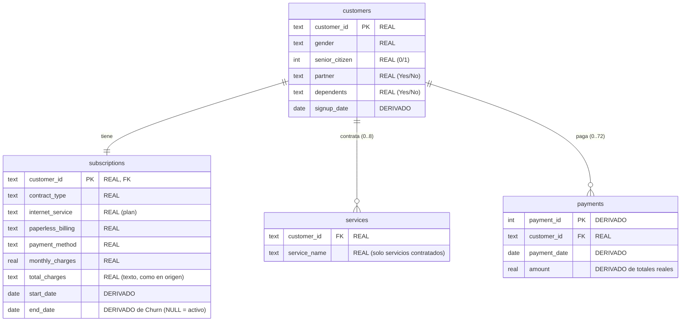
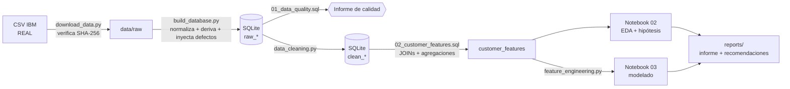

# Diseño del proyecto — Customer Churn Analysis & Prediction

**Fase 1 · Documento de diseño · v1.0 · 2026-10-20**

Este documento fija, **antes de analizar los datos**, qué problema resolvemos, con qué datos, qué hipótesis vamos a contrastar, con qué criterio las daremos por buenas y cómo vamos a trabajar. Se versiona en Git antes que cualquier análisis: así el historial demuestra que hipótesis y criterios no se ajustaron a posteriori a lo que salió.

> **En sencillo:** primero decimos qué esperamos encontrar y cómo lo vamos a medir; después miramos los datos. Si lo hiciéramos al revés, sería muy fácil "encontrar" justo lo que ya habíamos visto.

---

## 1. Problema de negocio

### 1.1 Contexto

Una operadora de telecomunicaciones (ficticia, ver §2) ofrece teléfono e internet a ~7.000 clientes. Cada mes una parte se da de baja (*churn*). Retener a un cliente suele ser más barato que captar uno nuevo, así que el equipo de retención quiere concentrar sus acciones (llamadas, ofertas, cambios de contrato) en los clientes con más riesgo, en lugar de contactar al azar o a todos.

### 1.2 Pregunta principal

> ¿Qué factores están asociados al abandono de clientes y podemos construir un modelo que identifique de forma fiable a los clientes con mayor riesgo de churn?

La descomponemos en tres preguntas, cada una con un tipo de análisis distinto:

| # | Pregunta | Tipo de análisis | Dónde se responde |
|---|---|---|---|
| P1 | ¿Qué características distinguen a los clientes que se van de los que se quedan? | Descriptivo + contraste de hipótesis | SQL, notebooks 01–02 |
| P2 | ¿Podemos ordenar a los clientes por riesgo mejor que una regla sencilla de negocio? | Predictivo (clasificación) | Notebook 03 |
| P3 | ¿Qué debería hacer la empresa y cómo comprobaría que funciona? | Recomendación + diseño de experimento | Informe final |

### 1.3 Definiciones

| Concepto | Definición en este proyecto |
|---|---|
| Unidad de análisis | El cliente. La tabla final tiene una fila por cliente. |
| `churn = 1` | El cliente se dio de baja en el último mes del periodo observado (definición de IBM). |
| `churn = 0` | El cliente sigue activo en la fecha de corte. |
| Fecha de corte | Momento en que se "hace la foto" de los datos. El dataset no trae fechas; asumimos `2024-10-01` (ver §3.3). |
| Decisión que apoya el modelo | Cada mes, elegir a qué clientes contactar con una acción de retención, con capacidad limitada. |

> **En sencillo:** no buscamos adivinar el futuro con precisión perfecta. Buscamos una lista ordenada de clientes, de más a menos riesgo, para que el equipo de retención empiece por los que más probabilidad tienen de irse.

### 1.4 Criterios de éxito

1. **Análisis:** cada hipótesis (§5) se evalúa con el criterio fijado aquí y se informa el resultado tal y como salga, incluidas las que se rechacen.
2. **Modelo:** supera a dos baselines en validación cruzada y en el test final: (a) un clasificador trivial que predice siempre "no churn" y (b) la regla de negocio "contrato mensual ⇒ riesgo de churn". Si no las supera, se informa así.
3. **Negocio:** el informe final traduce los resultados en acciones concretas, separa lo que los datos muestran de lo que proponemos y añade un experimento para validar la acción.

### 1.5 Fuera de alcance

- Estimar efectos causales ("si cambias su contrato, se queda"). Para eso proponemos un experimento (A/B test).
- Poner el modelo en producción, scoring en tiempo real o monitorización.
- Modelos complejos (gradient boosting, redes neuronales) o AutoML: no aportan al objetivo de aprender a construir y evaluar bien un modelo.

---

## 2. Dataset

### 2.1 Elección: IBM Telco Customer Churn

| | |
|---|---|
| **Fuente** | IBM, repositorio [`IBM/telco-customer-churn-on-icp4d`](https://github.com/IBM/telco-customer-churn-on-icp4d), fichero `data/Telco-Customer-Churn.csv` |
| **URL fijada a un commit** | `https://raw.githubusercontent.com/IBM/telco-customer-churn-on-icp4d/1fd6fd70906479be1712e64cfc0ea89f58466629/data/Telco-Customer-Churn.csv` |
| **Integridad** | SHA-256 `16320c9c1ec72448db59aa0a26a0b95401046bef5d02fd3aeb906448e3055e91` (el script de descarga lo verificará) |
| **Licencia** | El repositorio se distribuye bajo **Apache License 2.0** (lo indican GitHub y su README) y el CSV forma parte de él. Apache 2.0 permite usar y redistribuir con atribución y copia de la licencia. *No es asesoramiento legal.* |
| **Naturaleza** | **Datos de muestra de una empresa ficticia.** IBM describe una operadora ficticia que daba teléfono e internet a 7.043 clientes en California. No son datos de clientes reales. |
| **Tamaño** | 7.043 filas × 21 columnas (≈ 0,97 MB) |
| **Estabilidad** | El repositorio está archivado (sin cambios desde 2020): el fichero no va a cambiar. |

Aunque la licencia permitiría subir el CSV al repositorio, **no lo versionamos**: lo descarga un script (`src/download_data.py`). Así cualquiera reproduce el proyecto desde cero y el repositorio no carga con datos.

### 2.2 Variables disponibles

Perfil estructural verificado al descargar el fichero. No se ha mirado todavía ninguna relación con el churn.

| Grupo | Columnas originales | Notas del perfil |
|---|---|---|
| Identificador | `customerID` | 7.043 valores únicos |
| Demografía | `gender`, `SeniorCitizen`, `Partner`, `Dependents` | `SeniorCitizen` viene como 0/1; el resto de binarias como Yes/No |
| Relación | `tenure` (meses como cliente) | 0–72, mediana 29. Hay 362 clientes con exactamente 72 → posible tope de la variable |
| Servicios | `PhoneService`, `MultipleLines`, `InternetService` y 6 servicios adicionales (`OnlineSecurity`, `OnlineBackup`, `DeviceProtection`, `TechSupport`, `StreamingTV`, `StreamingMovies`) | Categorías redundantes "No internet service" / "No phone service" |
| Contrato y facturación | `Contract`, `PaperlessBilling`, `PaymentMethod`, `MonthlyCharges`, `TotalCharges` | `MonthlyCharges` 18,25–118,75. `TotalCharges` se lee como texto: 11 vacíos |
| Objetivo | `Churn` | 1.869 "Yes" de 7.043 → **26,5 %** |

Observaciones de calidad ya visibles (se tratan en la Fase 2):

- **Sin duplicados** en el CSV original: `customerID` es único y no hay filas repetidas.
- **11 `TotalCharges` vacíos**, todos con `tenure = 0`: clientes recién dados de alta que todavía no han recibido factura. No es un dato perdido al azar; es un 0 estructural.
- **`TotalCharges` frente a `tenure × MonthlyCharges`:** el cociente va de 0,69 a 1,57 (mediana 1,00). La cuota actual no siempre coincide con lo pagado de media en el pasado. De aquí sale la hipótesis H6.
- **Desbalance moderado** (26,5 % churn): usaremos `stratify` al dividir train/test.

### 2.3 Por qué es adecuado

- **Licencia explícita y descarga sin cuenta** → el proyecto se reproduce desde cero con un comando.
- **Objetivo claro y variables de negocio interpretables** (contrato, precio, servicios, antigüedad, método de pago): se puede explicar a alguien no técnico.
- **Mezcla de variables numéricas y categóricas** → permite estadística descriptiva, codificación, escalado y comparar modelos.
- **Tamaño adecuado:** cabe de sobra en un portátil y da para train/test y validación cruzada.
- **Normalizarlo en tablas tiene precedente:** el propio tutorial de IBM lo usa partido en tres tablas (`CUSTOMERS`, `PRODUCTS`, `BILLING`) unidas con JOIN.
- **Es conocido**, así que un entrevistador lo sitúa rápido. La contrapartida es que está muy usado: nos diferenciamos por el proceso (SQL, hipótesis fijadas de antemano, control de leakage, traducción a negocio), no por el dataset.

### 2.4 Limitaciones del dataset (conocidas desde el diseño)

1. **Datos ficticios.** Las conclusiones son una demostración metodológica sobre una empresa simulada, no hechos sobre clientes reales.
2. **Una sola foto, sin fechas.** No hay historial; no podemos validar el modelo hacia el futuro. Las variables y la etiqueta describen el mismo momento: el modelo identifica qué clientes se parecen a los que se van (perfil de riesgo), no predice con antelación validada.
3. **Tasa de churn poco realista.** Un 26,5 % de bajas en un mes está muy por encima de lo habitual en el sector. Probablemente la muestra tiene más bajas de lo normal. Con una tasa real más baja, la precisión del modelo sería menor.
4. **Faltan variables clave:** uso real (minutos, datos), llamadas a soporte, incidencias, pagos fallidos, satisfacción, ofertas de la competencia y motivo de baja. Hay riesgo de sesgo por variables omitidas.
5. **No distingue churn voluntario** (el cliente se va) **de involuntario** (baja por impago).
6. **Un único mercado (California) y una única empresa** → generalización limitada.
7. **Sin historial de cambios de plan:** solo tenemos la cuota actual y el total acumulado.
8. **Subgrupos pequeños** al cruzar varias variables → intervalos de confianza anchos.

### 2.5 Alternativas descartadas

| Dataset | Por qué no |
|---|---|
| KKBox Churn (WSDM Cup 2018, Kaggle) | Multi-tabla con logs de uso reales (en teoría ideal), pero ocupa decenas de GB, exige cuenta de Kaggle y aceptar las normas de la competición. Excesivo para un proyecto junior. |
| IBM Telco 11.1.3+ (versión ampliada) | Más variables (edad, ciudad, referidos, GB descargados, satisfacción), pero circula en copias de terceros con licencia poco clara y versiones que no coinciden entre sí (unas dicen Q2, otras Q3). Queda como mejora futura. |
| Bank Customer Churn (Kaggle) | Una sola tabla, licencia poco clara y no es un negocio de suscripción. |
| Datos 100 % sintéticos | Los patrones serían los que programásemos: "descubriríamos" lo que nosotros mismos pusimos. |

---

## 3. Modelo de datos

### 3.1 Por qué varias tablas si el CSV es una sola

En una empresa real estos datos viven en sistemas distintos (CRM, contratación, catálogo de servicios, facturación) y el analista los une con SQL. Normalizamos el CSV en cuatro tablas para reproducir esa situación de forma honesta: **la información es la misma, solo cambia cómo está organizada**. Un test comprobará que unir las tablas reconstruye exactamente el CSV original, es decir, que no se pierde ni se inventa nada.

> **En sencillo:** partimos una hoja de cálculo grande en varias tablas más pequeñas conectadas por `customer_id`, como estarían en la base de datos de una empresa. Luego usamos SQL para volver a juntarlas y calcular indicadores por cliente.

### 3.2 Origen de cada dato: tres etiquetas

Cada columna del [diccionario de datos](data_dictionary.md) lleva una de estas etiquetas:

| Etiqueta | Significado |
|---|---|
| **REAL** | Valor tal cual viene en el CSV de IBM (puede estar renombrado o reorganizado). |
| **DERIVADO** | Calculado de forma determinista a partir de valores reales y una suposición documentada (por ejemplo, la fecha de corte). No añade información nueva. |
| **SINTÉTICO** | Introducido por nosotros. **Solo** lo usamos para inyectar defectos de calidad controlados (§3.6). Nunca para crear patrones de comportamiento. |

### 3.3 Fecha de corte (suposición)

El dataset no tiene fechas. IBM habla de un trimestre (Q3) pero sin año. Asumimos **fecha de corte = `2024-10-01`** (cierre del Q3) para convertir "meses de antigüedad" en fechas:

- `signup_date = start_date = fecha de corte − tenure meses`. Siempre día 1, para que las cuentas de meses sean exactas.
- Clientes con baja: `end_date = fecha de corte`. Se dieron de baja durante el último mes y no sabemos el día exacto.
- `tenure` **no se guarda**: se recalcula en SQL a partir de las fechas. Sirve para practicar funciones de fecha y, de paso, comprueba que la derivación es correcta.

**Consecuencia:** cualquier análisis de calendario (estacionalidad, "los que entraron en enero…") sería un artefacto de esta suposición y no se hará. Los análisis por antigüedad sí son válidos, porque equivalen a usar `tenure`.

### 3.4 Tablas



| Tabla | Granularidad | Filas esperadas | Qué demuestra en SQL |
|---|---|---|---|
| `customers` | 1 por cliente | 7.043 (+ duplicados inyectados) | Detección de duplicados, `CASE WHEN` para normalizar 0/1 vs Yes/No |
| `subscriptions` | 1 por cliente | 7.043 | Funciones de fecha, definición de churn, limpieza de categorías y tipos |
| `services` | 1 por servicio contratado | 0–8 por cliente | **LEFT JOIN** obligatorio: 80 clientes no tienen ningún servicio en esta tabla y desaparecerían con un INNER JOIN. Pivotado con agregación condicional |
| `payments` | 1 por mes facturado | 227.990 (+ defectos inyectados) | `GROUP BY` / `HAVING`, agregaciones, window functions, conciliación con `total_charges`, IDs huérfanos, fechas imposibles |

**Notas de diseño:**

- **Churn no es una columna.** Se define en SQL a partir del sistema de contratación: `CASE WHEN end_date IS NOT NULL THEN 1 ELSE 0 END`. En una empresa real "churn" no viene dado: hay que definirlo, y esa definición es una decisión de negocio.
- **`internet_service` hace el papel de "plan"** (DSL / Fibra / Sin internet).
- **`services` en formato largo:** solo hay filas para servicios contratados ("Yes"). "No" y "No internet service" se recuperan sin pérdida combinándola con `internet_service`.
- **`payments` es una reconstrucción determinista:** el último pago es la cuota actual real (`monthly_charges`) y los anteriores reparten a partes iguales el resto del total real: `(total_charges − monthly_charges) / (tenure − 1)`. Así `SUM(amount) = total_charges` y la cuota media histórica es real. Lo que es una suposición es el reparto mes a mes, y por eso **no se usarán como variables los importes de meses concretos** (por ejemplo, "variación de los últimos 3 meses"): reflejarían nuestra suposición, no los datos.
- Clientes con `tenure = 0` no tienen pagos.

### 3.5 Lo que NO simulamos, y por qué

Tu esquema ideal incluía uso (sesiones, minutos) y pagos fallidos. Estos datos **no existen** en el dataset. Si los inventáramos, cualquier hallazgo sobre ellos ("menos uso ⇒ más churn") se cumpliría solo porque lo habríamos programado así, y eso no se podría defender en una entrevista. Los sustituimos por equivalentes reales:

| Esquema ideal | Equivalente en este proyecto | Origen |
|---|---|---|
| `customers.age` | `senior_citizen` (solo indica si es mayor; sin edad exacta) | REAL |
| `customers.country` | No disponible (un solo mercado, California) | — |
| `customers.acquisition_channel` | No disponible | — |
| `customers.signup_date` | `signup_date` | DERIVADO |
| `subscriptions.plan` | `internet_service` | REAL |
| `subscriptions.monthly_price` | `monthly_charges` | REAL |
| `subscriptions.start_date / end_date` | `start_date / end_date` | DERIVADO |
| `usage.sessions / minutes / features_used` | **Adopción de servicios** (nº y tipo de servicios contratados, tabla `services`) | REAL |
| `payments.date / amount` | `payments` reconstruida | DERIVADO |
| `payments.payment_status` (fallidos) | **Método de pago manual vs automático** | REAL |
| `churn` | `end_date IS NOT NULL` | REAL (codificado) |

### 3.6 Defectos de calidad inyectados (SINTÉTICO, controlado)

**Por qué:** el CSV de IBM está muy limpio (solo los 11 vacíos de `TotalCharges`). Para demostrar consultas de calidad y una limpieza seria necesitamos los problemas típicos de una extracción real. Los inyectamos de forma reproducible (`seed = 42`), en pocas filas, y registramos cada uno en un manifiesto (`data/raw/injected_defects.csv`).

**Regla clave:** el código de limpieza **no lee el manifiesto**, porque eso sería hacer trampa. Solo los tests lo usan para comprobar que la limpieza encontró y corrigió todos los defectos sin tocar nada más.

| ID | Tabla | Defecto inyectado | Filas | Cómo debe detectarse (SQL) | Corrección esperada |
|---|---|---|---|---|---|
| D1 | `customers` | Filas duplicadas exactas | 20 | `GROUP BY customer_id HAVING COUNT(*) > 1` | Eliminar duplicados exactos |
| D2 | `subscriptions` | Etiquetas inconsistentes en `payment_method` y `contract_type` (mayúsculas, espacios) | 70 | `GROUP BY` sobre la columna: aparecen variantes | `TRIM` + mapeo a la categoría canónica |
| D3 | `subscriptions` | `monthly_charges` ×100 (error de coma decimal) | 10 | Valores fuera de rango plausible / outliers por IQR | Recuperar desde el último pago (cruce con `payments`) |
| D4 | `subscriptions` | `monthly_charges` a NULL | 10 | `IS NULL` | Recuperar desde el último pago |
| D5 | `payments` | Pagos duplicados (mismo cliente, fecha e importe; distinto `payment_id`) | 50 | `GROUP BY customer_id, payment_date, amount HAVING COUNT(*) > 1` | Conservar uno |
| D6 | `payments` | Pagos huérfanos (`customer_id` inexistente) | 30 | `LEFT JOIN customers … WHERE c.customer_id IS NULL` | Excluir (no se pueden atribuir) |
| D7 | `payments` | Pagos con fecha posterior al corte (registros de prueba) | 10 | `payment_date >= fecha de corte` | Excluir |

D3 y D4 solo afectan a clientes con `tenure ≥ 1`, que tienen pagos desde los que recuperar el valor. Hay que ser honestos: en nuestros datos el último pago coincide con la cuota *por construcción*. En una empresa real ese cruce entre contratación y facturación es una comprobación legítima, pero aquí funciona porque nosotros construimos la tabla así.

Además están los **problemas reales** del CSV, que no inyectamos nosotros:

| ID | Problema real | Tratamiento previsto (se decide y justifica en la Fase 2) |
|---|---|---|
| R1 | `total_charges` es texto y tiene 11 vacíos (todos con `tenure = 0`) | Convertir a número; los vacíos son 0 estructurales, no datos perdidos |
| R2 | `senior_citizen` en 0/1 y el resto de binarias en Yes/No | Unificar a 0/1 con `CASE WHEN` |
| R3 | Categorías redundantes "No internet service" / "No phone service" | Se resuelven al normalizar (formato largo + `internet_service`) |
| R4 | 362 clientes con `tenure` = 72 (el máximo) | Investigar si es un tope; si lo es, documentarlo como limitación |
| R5 | `total_charges ≈ tenure × monthly_charges` | Multicolinealidad: decidir en la Fase 4 qué variables entran en el modelo |

**Resultado esperado:** tras la limpieza, las tablas limpias reconstruyen exactamente el CSV original. Ese será un test automático.

---

## 4. Data leakage: riesgos identificados desde el diseño

> **En sencillo:** hay *leakage* (fuga de información) cuando el modelo aprende con información que en la vida real no tendría en el momento de decidir. Da métricas espectaculares en el portátil que luego fallan en la realidad. Es como hacer un examen habiendo visto las respuestas.

| ID | Riesgo | Por qué es leakage | Cómo lo evitamos |
|---|---|---|---|
| L1 | `end_date` (y cualquier "estado" de la suscripción) | Define el objetivo: `end_date` no nulo ⇔ churn | Nunca entra como variable. Solo se usa para construir `churn` |
| L2 | Variables calculadas con `end_date` ("días hasta la baja", "antigüedad hasta la baja") | Codifican el objetivo de forma indirecta | La antigüedad se calcula siempre hasta la fecha de corte, igual para todos |
| L3 | Variables medidas a la vez que la etiqueta (`tenure`, `total_charges`) | En una foto única, describen al cliente justo cuando se va | Aceptable aquí porque todas las bajas son del último mes (todas las variables se miden en el mismo momento). En un proyecto real: variables hasta la fecha T y etiqueta en la ventana (T, T+30 días]. Lo documentamos como limitación |
| L4 | Preprocesado sobre todos los datos (escalar, codificar o imputar antes de dividir) | El train "ve" estadísticas del test | Todo el preprocesado va dentro de un `Pipeline` que solo se ajusta con train |
| L5 | Elegir umbral, variables o hiperparámetros mirando el test | El test deja de ser una evaluación independiente | Esas decisiones se toman con validación cruzada sobre train. El test se usa **una sola vez**, al final |
| L6 | Clientes duplicados repartidos entre train y test | El modelo se evalúa sobre clientes que ya vio | Se deduplica antes de dividir y un test comprueba que `customer_id` es único |
| L7 | Importes de meses concretos en `payments` | Son nuestra suposición de reparto, no datos reales | Solo usamos agregados que reproducen valores reales (total, media histórica, nº de pagos) |
| L8 | Manifiesto de defectos usado en la limpieza | Sería "limpiar con las respuestas" | La limpieza no lo lee; solo los tests |

Residual reconocido: el análisis descriptivo (notebook 02) usa todos los clientes, porque describe el negocio. Las decisiones de modelado se validan solo con train.

---

## 5. Hipótesis (fijadas antes del análisis)

Las hipótesis recogen creencias habituales de negocio. **Algunas pueden no cumplirse, y eso también es un resultado.** El dataset es muy conocido y algunos de sus patrones generales están publicados. Por eso fijamos aquí los criterios de decisión y reportaremos los resultados tal y como salgan.

### 5.1 Criterio común de decisión

- **Comparación:** tasa de churn por grupo con intervalo de confianza del 95 %.
- **Contraste estadístico:** chi-cuadrado de independencia para variables categóricas; Mann-Whitney U para numéricas (no exige normalidad y estas variables son asimétricas). α = 0,05.
- **Relevancia práctica:** con 7.043 clientes, diferencias pequeñas salen "significativas". Por eso exigimos además una **diferencia mínima de 5 puntos porcentuales** de tasa de churn entre los grupos comparados.
- **Veredicto:** *Apoyada* (dirección esperada + p < 0,05 + ≥ 5 pp), *Rechazada* (sin diferencia relevante o dirección contraria), *Parcialmente apoyada* (se cumple solo en parte de los grupos o subgrupos).
- **Comparaciones múltiples:** como hacemos 8 contrastes, también comprobamos si el resultado se mantiene con α corregida por Bonferroni (0,05 / 8 ≈ 0,006).
- **Ninguna hipótesis prueba causalidad.** "Apoyada" significa "asociación observada en estos datos", no "X provoca churn".

> **En sencillo:** el p-valor responde "¿podría esta diferencia ser pura casualidad?". La diferencia en puntos responde "¿es lo bastante grande como para importarle al negocio?". Necesitamos las dos.

### 5.2 Hipótesis

| ID | Hipótesis | Variables | Análisis | Limitación prevista |
|---|---|---|---|---|
| **H1** | Los clientes con **menor adopción de servicios adicionales** presentan mayor churn (sustituye a "menor uso") | Nº de servicios adicionales (0–6), solo clientes con internet (5.517) | Tasa de churn por nº de servicios; diferencia 0 vs ≥ 3; chi-cuadrado. Desglose por tipo de servicio | Contratar servicios no es "usar" el producto. Se restringe a clientes con internet porque los que no lo tienen no pueden contratar extras y mezclarlos sesgaría la comparación |
| **H2** | Los clientes con **pago manual** (cheque electrónico o postal) presentan mayor churn que los de pago automático (sustituye a "pagos fallidos") | `payment_method` agrupado en manual / automático | Tasa por grupo y por los 4 métodos; chi-cuadrado | El método de pago puede reflejar otro perfil de cliente (variable de confusión) |
| **H3** | Los **contratos mensuales** presentan mayor churn que los de 1 año, y estos más que los de 2 años | `contract_type` | Tasa por tipo; chi-cuadrado; diferencias entre pares | El tipo de contrato está muy ligado a la antigüedad |
| **H4** | Los **clientes nuevos** (< 12 meses) presentan mayor churn | `tenure` | Tasa < 12 vs ≥ 12 y por tramos (0–6, 7–12, 13–24, 25–48, 49–72); Mann-Whitney de `tenure` entre churn y no churn | Hay sesgo de supervivencia: los clientes antiguos son, por definición, los que no se fueron antes |
| **H5** | Los clientes con **cuota mensual más alta** presentan mayor churn | `monthly_charges` | Medianas churn vs no churn; Mann-Whitney; tasa por cuartiles | La cuota depende de los servicios contratados (confusión con plan y servicios) |
| **H6** | Los clientes cuya **cuota actual supera su media histórica** (subida de precio) presentan mayor churn | Cociente `monthly_charges / media histórica de pagos`, solo `tenure ≥ 2` | Grupos subida (> +5 %), estable y bajada (< −5 %); chi-cuadrado; control por tramo de antigüedad | Interpretamos la diferencia como cambio de precio, pero podría deberse a cargos puntuales, descuentos o al ruido con el que IBM generó los datos |
| **H7** | Los clientes con **factura electrónica** presentan **menor** churn (creencia "digital = más comprometido") | `paperless_billing` | Tasa por grupo; chi-cuadrado | Puede ser un indicador de otro perfil (edad, tipo de contrato) |
| **H8** (control) | El **género no está asociado** al churn | `gender` | Diferencia de tasas con IC 95 %; chi-cuadrado. Se mantiene si p ≥ 0,05 **y** el IC de la diferencia queda dentro de ±3 pp | No encontrar diferencia no demuestra que no exista; por eso usamos el margen de ±3 pp. Si el género no aporta, sirve para justificar no usar una variable sensible en el modelo |

Las variables de H1, H5 y H6 están relacionadas con el precio y los servicios, así que se solapan. En la Fase 3 miraremos también sus correlaciones para no contar el mismo efecto dos veces.

---

## 6. Plan analítico y de modelado (resumen)

### 6.1 EDA y estadística (Fases 2–3)

- **Calidad y limpieza:** consultas SQL de calidad sobre las tablas en crudo → limpieza en Pandas con cada decisión justificada → tablas limpias.
- **Descriptivos:** media, mediana, desviación típica, percentiles, mínimo y máximo, asimetría (*skewness*) en las numéricas; frecuencias en las categóricas.
- **Distribuciones:** histogramas y boxplots por grupo de churn.
- **Relaciones:** correlaciones de Pearson y de Spearman entre numéricas; V de Cramér entre categóricas y churn; matriz de correlaciones.
- **Hipótesis:** H1–H8 con el criterio de §5.1.
- **Gráficos:** cada uno responde a una pregunta. Previstos: distribución del churn, distribuciones numéricas, churn por contrato, por plan (`internet_service`), por segmento demográfico (sustituye a "por país"), por tramo de antigüedad, por adopción de servicios, por método de pago y matriz de correlaciones.

### 6.2 Modelado (Fases 4–6)

| Paso | Decisión | Por qué |
|---|---|---|
| División | Train 80 % / test 20 %, `stratify=churn`, `random_state=42` | Mantener la proporción de churn en ambos conjuntos; resultados reproducibles |
| Validación | Validación cruzada estratificada de 5 *folds* sobre train | Comparar modelos y ajustar hiperparámetros sin tocar el test |
| Baselines | `DummyClassifier` + regla "contrato mensual ⇒ churn" | Ver si el modelo aporta algo frente a no hacer nada y frente al sentido común del negocio |
| Modelos | Regresión logística y Random Forest | Uno interpretable y lineal, otro no lineal. No es una competición de modelos |
| Preprocesado | `Pipeline` + `ColumnTransformer` (`StandardScaler` en numéricas, `OneHotEncoder` en categóricas) | Evita leakage (L4) y deja el flujo en un único objeto |
| Desbalance | Comparar `class_weight="balanced"` con ajuste del umbral. Sin SMOTE | Sencillo, sin librerías extra |
| Métricas | Accuracy, precision, recall, F1, ROC-AUC, matriz de confusión (+ PR-AUC como apoyo) | Ver §6.3 |
| Umbral | Se elige con predicciones de validación cruzada sobre train, según capacidad y coste del equipo de retención | No elegirlo con el test (L5) |
| Interpretación | Coeficientes de la logística (odds ratios) + *permutation importance* en ambos modelos | Comparable entre modelos y menos sesgada que la importancia por impureza del Random Forest |

### 6.3 Qué métrica importa (avance; se decide en la Fase 6)

Con un 26,5 % de churn, un modelo que diga siempre "no se va" acierta un 73,5 %: **la accuracy engaña**. Para el negocio importa sobre todo:

- **Recall de la clase churn:** de los que se van, ¿a cuántos detectamos? Cada baja no detectada es un cliente que perdemos sin intentarlo.
- **Precision:** de los que contactamos, ¿cuántos se iban de verdad? Cada falso positivo gasta capacidad del equipo y quizá un descuento innecesario.

El equilibrio depende de cuánto cuesta una acción de retención frente a cuánto vale un cliente, y de cuántos clientes puede contactar el equipo al mes. No asumiremos "recall es lo más importante" sin hacer esa cuenta.

---

## 7. Arquitectura

### 7.1 Stack y por qué

| Herramienta | Uso | Por qué esta y no otra |
|---|---|---|
| Python 3.13 | Lenguaje principal | Ya instalado; tiene todas las librerías necesarias |
| `venv` + `pip` + `requirements.txt` | Entorno reproducible | Viene con Python. Conda o Poetry no aportan nada aquí |
| SQLite (`sqlite3` de la librería estándar) | Base de datos para SQL | Sin servidor ni instalación; un único fichero; soporta CTEs, window functions y funciones de fecha. Pandas lo lee con `read_sql_query` |
| Pandas, NumPy | Limpieza, transformación, análisis | Estándar del sector |
| SciPy (`scipy.stats`) | Chi-cuadrado, Mann-Whitney | Ya es una dependencia de scikit-learn: no añade peso |
| Matplotlib, Seaborn | Gráficos | Seaborn para gráficos estadísticos rápidos; Matplotlib para ajustes finos |
| Scikit-learn | Pipelines, modelos, métricas | Requisito del proyecto |
| Jupyter | Notebooks de análisis | Requisito. Se ejecutan con `jupyter nbconvert --execute` para comprobar que corren de principio a fin |
| pytest | Tests | Sencillo y estándar |
| Git + GitHub (CLI `gh`) | Ramas, PRs, revisión | `gh` ya está instalado y autenticado |
| Mermaid (en Markdown) | Diagramas del README y de este documento | GitHub lo renderiza; no hace falta otra herramienta |

**Lo que NO usamos, a propósito:** Docker, DVC, MLflow, Airflow, dbt, PostgreSQL, XGBoost/LightGBM, SHAP, imbalanced-learn. Todas son útiles en otros contextos, pero aquí añaden complejidad sin ayudar a demostrar los requisitos.

### 7.2 Estructura del repositorio

```
customer-churn-analysis/
├── README.md
├── requirements.txt
├── .gitignore
├── data/                          # NO versionado (se regenera con el pipeline)
│   ├── raw/                       # CSV de IBM + manifiesto de defectos inyectados
│   ├── processed/                 # customer_features.csv (tabla final por cliente)
│   └── churn.db                   # SQLite: tablas raw_* y clean_*
├── docs/
│   ├── 01_project_design.md       # este documento
│   ├── data_dictionary.md         # columnas, tipos y origen (REAL/DERIVADO/SINTÉTICO)
│   └── pull_requests/             # descripción de cada PR (portfolio)
├── sql/
│   ├── 00_schema.sql              # CREATE TABLE: el modelo de datos en código
│   ├── 01_data_quality.sql        # duplicados, NULLs, imposibles, huérfanos, fechas, extremos
│   ├── 02_customer_features.sql   # JOIN de las 4 tablas → tabla por cliente
│   └── 03_analysis.sql            # preguntas de negocio en SQL (tasas por segmento…)
├── src/
│   ├── __init__.py
│   ├── config.py                  # rutas, fecha de corte, semilla: un único sitio
│   ├── database.py                # conexión y ejecución de ficheros .sql
│   ├── download_data.py           # descarga + verificación SHA-256
│   ├── build_database.py          # CSV → tablas normalizadas + defectos inyectados
│   ├── data_cleaning.py           # raw_* → clean_*
│   ├── feature_engineering.py     # variables extra + ColumnTransformer
│   ├── modeling.py                # baselines, pipelines, CV, evaluación
│   └── pipeline.py                # ejecuta todo de principio a fin con un comando
├── notebooks/
│   ├── 01_data_exploration.ipynb  # carga, calidad, limpieza explicada
│   ├── 02_statistical_analysis.ipynb  # descriptivos, hipótesis, gráficos
│   └── 03_modeling.ipynb          # baselines, modelos, métricas, interpretación
├── tests/
│   ├── test_data_pipeline.py      # reconstrucción sin pérdida + limpieza corrige defectos
│   └── test_features.py           # id único, churn ∈ {0,1}, sin negativos, sin NaN
└── reports/
    ├── analysis_report.md         # Executive Summary + informe técnico
    └── figures/                   # gráficos exportados para README e informe
```

**Cambios respecto a la estructura propuesta, y por qué:**

- `docs/`: diseño, diccionario de datos y descripciones de PR. Es documentación del proyecto, no del análisis.
- `sql/00_schema.sql`: el modelo de datos queda escrito en SQL, revisable en un PR.
- `src/config.py`, `src/database.py`, `src/download_data.py`, `src/build_database.py`, `src/pipeline.py`: hacen el proyecto reproducible desde cero y evitan repetir rutas y conexiones en cada notebook.
- `tests/test_data_pipeline.py`: un segundo fichero pequeño para los tests de datos. Unos 10 tests en total; no es un proyecto de testing.
- `reports/figures/`: los gráficos del README tienen que ser ficheros.

### 7.3 Flujo de datos



**Reparto de responsabilidades (para no duplicar lógica):**

- **SQL** une tablas y agrega (lo que en una empresa se haría en el *data warehouse*).
- **Pandas** limpia y analiza.
- **Scikit-learn** hace todo lo que "aprende" de los datos (escalado, codificación, modelos), siempre dentro del `Pipeline`.
- **Notebooks:** explican y muestran. **`src/`:** contiene la lógica reutilizable. Los notebooks importan de `src/`; no copian código.

### 7.4 Decisiones de versionado

| Qué | ¿Se versiona? | Por qué |
|---|---|---|
| Datos (`data/`) | No | Se regeneran con `python -m src.pipeline`; el repositorio queda ligero |
| Notebooks | Sí, **con salidas** | Quien visite GitHub ve resultados y gráficos sin ejecutar nada. Coste: diffs más ruidosos en los PRs |
| Figuras (`reports/figures/`) | Sí | Las usa el README |

---

## 8. Roadmap

Cada fase se desarrolla en su rama y entra en `develop` mediante un Pull Request. El estado se actualiza al cerrar cada fase.

| Fase | Objetivo | Entregables principales | Rama → PR | Estado |
|---|---|---|---|---|
| 1. Diseño | Problema, dataset, modelo de datos, hipótesis, arquitectura | `docs/01_project_design.md`, `docs/data_dictionary.md`, esqueleto del repo | `feature/project-design` → PR #1 | En revisión |
| 2a. Pipeline de datos | Descarga reproducible y base de datos normalizada | `config.py`, `database.py`, `download_data.py`, `build_database.py`, `00_schema.sql`, `requirements.txt`, test de reconstrucción | `feature/data-pipeline` → PR #2 | Pendiente |
| 2b. Calidad y limpieza | Detectar y corregir problemas | `01_data_quality.sql`, `data_cleaning.py`, notebook 01, tests de limpieza | `feature/data-quality` → PR #3 | Pendiente |
| 2c. SQL de negocio | Tabla final por cliente y consultas analíticas | `02_customer_features.sql`, `03_analysis.sql` | `feature/sql-features` → PR #4 | Pendiente |
| 3. EDA y estadística | Descriptivos, distribuciones, hipótesis H1–H8 | Notebook 02, `reports/figures/` | `feature/eda-statistics` → PR #5 | Pendiente |
| 4. Feature engineering | Variables, preprocesado, control de leakage | `feature_engineering.py`, `test_features.py` | `feature/feature-engineering` → PR #6 | Pendiente |
| 5–6. Modelado y evaluación | Baselines, logística, Random Forest, métricas, umbral, interpretación | `modeling.py`, notebook 03 | `feature/modeling` → PR #7 | Pendiente |
| 7–8. Recomendaciones y documentación | Executive Summary, informe técnico, README final | `reports/analysis_report.md`, `README.md` | `feature/documentation` → PR #8 | Pendiente |
| 9. Git/GitHub | Transversal: se aplica en cada fase. Al final se pulen las descripciones de PR para el portfolio | `docs/pull_requests/` | (en cada PR) | Transversal |
| 10. Revisión final | Ejecución desde cero, revisión crítica, release | Checklist de portfolio, tag `v1.0.0` | `develop` → `main` (PR de release) | Pendiente |

---

## 9. Estrategia Git (resumen; el detalle llega en la Fase 9)

- **Ramas:** `main` (solo versiones publicadas), `develop` (integración) y `feature/<tema>` (una por fase, creada desde `develop`).
- **Nunca se trabaja directamente en `main`.** El primer commit (esqueleto vacío) es la única excepción, porque un repositorio necesita una base.
- **Commits:** formato *Conventional Commits*, pequeños y con un único propósito. Por ejemplo:
  - `docs: add project design and data dictionary`
  - `feat: build normalized SQLite database from IBM csv`
  - `fix: treat blank total_charges as structural zero`
  - `test: verify normalized tables rebuild the original csv`
- **Pull Requests:** cada uno con *Title, Description, Changes, Validation, Potential issues* (plantilla en `docs/pull_requests/`).
- **Merge:** *merge commit* hacia `develop`, para conservar en el historial los commits de cada rama y que se vea el flujo de trabajo. La release `develop → main` se etiqueta como `v1.0.0`.
- **Prueba de que las hipótesis se fijaron antes:** este documento entra en el PR #1, antes de cualquier análisis. El historial de Git lo demuestra.

---

## 10. Cómo contar esta fase en una entrevista

> "Antes de tocar los datos, definí el problema como una decisión de negocio: a qué clientes contactar para retenerlos. Elegí un dataset público con licencia clara y lo normalicé en cuatro tablas para trabajar con SQL como en una empresa. Documenté qué datos eran reales, cuáles derivados y cuáles defectos inyectados a propósito para probar la limpieza. No simulé uso ni pagos fallidos, porque los hallazgos habrían sido los que yo programase. Fijé ocho hipótesis y el criterio para aceptarlas antes de analizar, e identifiqué desde el principio las posibles fuentes de leakage."

---

## Fuentes

- Repositorio y licencia: [IBM/telco-customer-churn-on-icp4d](https://github.com/IBM/telco-customer-churn-on-icp4d) (Apache 2.0, archivado; fichero añadido en el commit `1fd6fd7`, 2019-09-30).
- Descripción del dataset (empresa ficticia, 7.043 clientes, California, churn = baja en el último mes): [IBM Community — Telco customer churn (11.1.3+)](https://community.ibm.com/community/user/businessanalytics/blogs/steven-macko/2019/07/11/telco-customer-churn-1113).
- Diferencias entre versiones de terceros (Q2 2022 vs Q3): [Maven Analytics — Telecom Customer Churn](https://mavenanalytics.io/project/4173).
